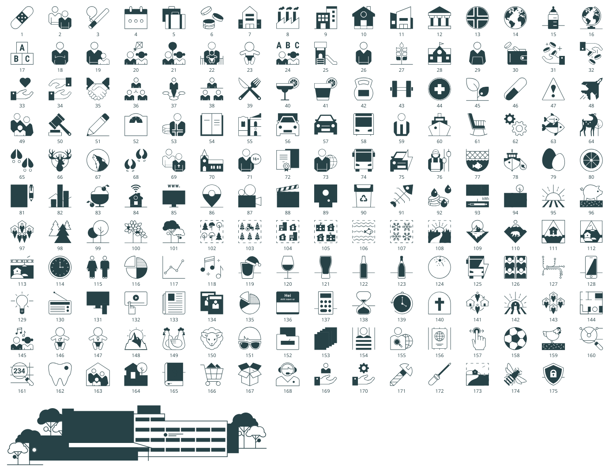

# SSB-ikoner som SVG

SSBs ikonsett, trukket ut fra ikonoversikten (PDF fra Illustrator, 4.3.2024) som egne SVG-filer, med en katalog som gjør det mulig å finne ikoner etter tema.

> **Bruk.** Ikonene er SSBs. Regler for bruk står i designhåndboka, og forespørsel om bruk sendes til profil@ssb.no. Dette repoet er laget for gjenbruk i interne prototyper og figurer, og er ikke en offisiell kilde til ikonene.



## Innhold

```
svg/ikon-001.svg … ikon-175.svg   ett ikon per fil, 80 × 80 viewBox
svg/ssb-kongsvinger.svg           illustrasjon av bygget på Kongsvinger
katalog.json                      nummer, filnavn, navn og stikkord for hvert ikon
oversikt.png                      alle ikonene på ett ark
index.html                        søkbar oversikt, åpnes i nettleser
kilde/                            original-PDF-en
scripts/trekk_ut.py               lager svg/ fra PDF-en
```

## Farger

Mørke flater bruker `currentColor`, med SSB mørk (#274247) som standard. De hvite flatene er faste, fordi ikonene er tofarget. Ikonet kan derfor fargelegges uten å endre filen:

```html
<span style="color:#00824d">…innholdet i ikon-023.svg…</span>
```

```python
inner = svg[svg.index(">") + 1 : svg.rindex("</svg>")]
f'<g transform="translate({x},{y}) scale({px / 80})" color="#00824d">{inner}</g>'
```

Ikonene er laget for lys bakgrunn og for SSB grønn, som i PDF-en.

## Katalogen

```json
{"nr": 23, "fil": "ikon-023.svg", "navn": "baby", "stikkord": ["fødsel", "fødte", "spedbarn"], "usikker": false}
```

PDF-en har bare nummer («Ikon 23»). Navn og stikkord er satt ved å se på ikonene. 18 er merket `usikker` fordi det ikke er åpenbart hva de skal vise. Rett gjerne i `katalog.json`.

## Oppdatere

Når det kommer en ny ikonoversikt, legges PDF-en i `kilde/` og skriptet kjøres:

```
pip install pymupdf
python scripts/trekk_ut.py kilde/<ny-pdf>.pdf svg
```

Skriptet leser vektorene på hver side, finner ikonene i øverste rad (hvit bakgrunn) og navngir dem etter etiketten under («Ikon N»). Nye ikoner må få navn og stikkord i `katalog.json` for hånd.

## Kjente svakheter

- **ssb-kongsvinger.svg**: noen hvite flater blir mørke. Illustrasjonen er ikke kontrollert mot originalen.
- Strektykkelsen følger originalen og skaleres med ikonet. Under om lag 24 px blir detaljer i de mest sammensatte ikonene (for eksempel 102–107) utydelige.
